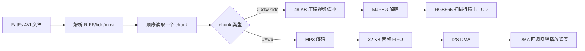
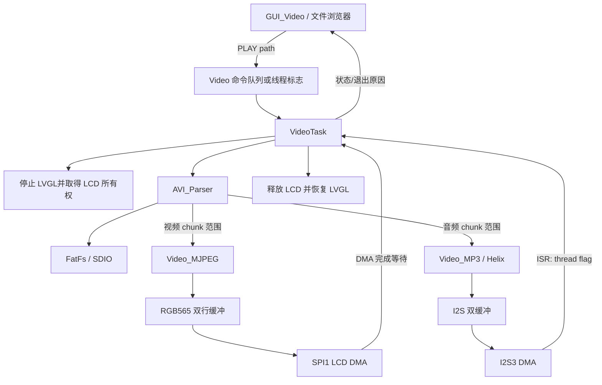
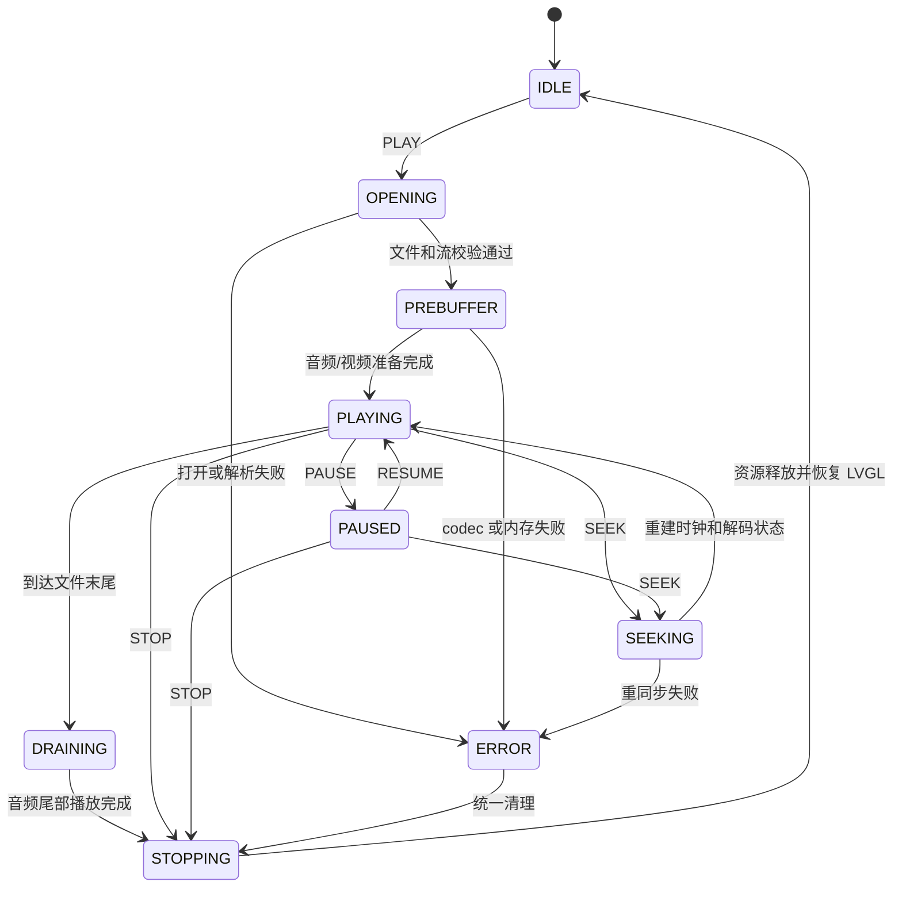

# Star Gamer AVI 视频播放器复刻方案

## 1. 结论

参考工程已经实现了一条可运行的 AVI 播放链路，但其容器解析、定位、调度和资源管理都与 Star Gamer 当前架构不兼容。建议复用其“AVI 分块读取 + MJPEG 解码 + MP3 解码 + I2S DMA”的总体思路，不直接复制代码。

Star Gamer 首版播放器建议明确限定为：

| 项目 | 首版支持范围 |
|---|---|
| 容器 | RIFF AVI |
| 视频编码 | MJPEG/MJPG |
| 视频尺寸 | 最大 320×240，不旋转、不放大 |
| 像素输出 | RGB565 |
| 音频编码 | 可选 MP3，单音轨 |
| 流数量 | 单视频流，最多单音频流 |
| 播放方式 | 顺序播放、暂停/恢复、停止，提供粗略跳转 |
| 显示方式 | 播放期间独占 LCD，暂停 LVGL |
| 不承诺支持 | H.264、MPEG-4 Part 2、AAC、任意 OpenDML、多音轨、字幕、任意分辨率缩放 |

推荐采用以下关键设计：

1. 由单个 `VideoTask` 串行执行 FatFs 读取、AVI demux、MJPEG 解码和 MP3 解码，避免多个任务竞争 SDIO。
2. AVI 解析使用显式小端读取和 RIFF 边界遍历，不使用 C 结构体直接映射文件数据。
3. MJPEG 使用带 chunk 边界的 LibJPEG `jpeg_source_mgr` 从 `FIL` 流式读取，取消参考工程的 48 KB 整帧压缩缓冲。
4. JPEG 按扫描行解码为 RGB565，以双行或小条带缓冲通过 SPI DMA 输出，不分配完整视频帧。
5. 播放开始时通过现有 `lvgl_stop_ui()` 取得 LCD/SPI1 所有权，结束后通过 `lvgl_start_ui()` 恢复 GUI。
6. 有音频时以已播放 PCM sample 数作为主时钟；无音频时使用 RTOS tick 的绝对时间点调度视频。
7. 视频落后时只丢视频帧，不丢音频数据，也不通过加速音频追赶。
8. 视频子系统独占片上 SRAM `0x2000C000..0x2001FFFF` 的 80 KB 对齐内存池；任务栈、FatFs/JPEG 对象、工作缓冲和 LCD DMA 条带均从该池分配，不经过 `sys_malloc`。

该方案适合 STM32F407ZGT6、SPI LCD 和现有 1 MB 外部 SRAM 的资源条件。实际可稳定达到的帧率和 JPEG 质量必须在真机上测量后确定，首版不应预先承诺 25/30 fps。

---

## 2. 参考工程调研

### 2.1 工程位置

参考工程：

```text
C:\Users\ZLK\Downloads\PuZhong_STM32F407_T100_I2S\
  PuZhong_STM32F407_T100_I2S\
  Program_STM32F407_T100\
  pro2_mp3_avi_nes_pic
```

AVI 播放相关文件：

```text
media/video/video_player.c
media/video/video_player.h
media/video/video_support.c
media/video/video_support.h
media/video/stream_decode/parse_avi.c
media/video/stream_decode/parse_avi.h
media/video/stream_decode/video_app.c
media/video/stream_decode/video_app.h
media/video/stream_decode/dec_mjpeg.c
media/video/stream_decode/dec_mjpeg.h
media/video/stream_decode/dec_mp3.c
media/video/stream_decode/dec_mp3.h
media/media_timer_v2.c
media/media_timer_v2.h
audio_card/audio_card.c
audio_card/audio_card.h
```

### 2.2 实际支持能力

参考工程的有效播放组合是：

- RIFF AVI 容器。
- `MJPG`/MJPEG 视频。
- 视频数据 chunk 为 `00dc` 或 `01dc`。
- MP3 音频格式码为 `0x0055`，音频数据 chunk 为 `##wb`。
- 解析器还识别 PCM 格式码 `0x0001`，但主要播放链路围绕 MP3 实现。
- JPEG 最大输出尺寸为 320×240。

源码中虽然存在 H.264 相关 FourCC 常量，但没有对应解码器，不能视为支持 H.264。

### 2.3 播放链路

参考工程按以下方式工作：



播放器一次处理一个 `movi` chunk，通过 chunk ID 后两字节的 `dc` 或 `wb` 判断视频和音频。MJPEG 解码后逐行输出 LCD，因此没有额外保留一张完整的 RGB565 解码帧。

音频侧将 MP3 解码结果写入 FIFO，I2S DMA 回调从 FIFO 中消费 PCM 并唤醒播放器。播放进度和控制图标直接合成到视频扫描行中。

### 2.4 参考工程资源使用

| 资源 | 参考工程用量或特征 |
|---|---:|
| 压缩视频 chunk 缓冲 | 48 KB |
| MJPEG 临时内存池 | 38 KB |
| 音频 FIFO | 32 KB |
| 单个 MP3 PCM 最大包 | 4608 B |
| JPEG 局部扫描行缓冲 | 约 2.5 KB |
| 完整 RGB565 视频帧 | 未分配 |
| LCD 输出 | JPEG 解码时逐行输出 |

上述固定缓冲占用较大，但“逐行输出、不保留完整视频帧”的方向是正确的。Star Gamer 的 LVGL 已固定占用 150 KB 外部 SRAM，更需要避免复制 48 KB 整帧压缩缓冲。

### 2.5 不能直接移植的问题

#### 2.5.1 AVI 解析不够安全

参考代码通过 C 结构体强转解析文件头，隐含依赖：

- 编译器结构体布局。
- 字节对齐方式。
- ARM 小端序。
- 文件数据完整且字段长度可信。

这会带来未对齐访问、越界读取和损坏文件触发异常的风险。Star Gamer 应使用 `read_le16()`、`read_le32()` 等显式读取函数，并在每次读取、跳过和长度相加前检查父 chunk 边界。

#### 2.5.2 跳转和时间估算不准确

参考工程不使用 `idx1`，而是按 `movi` 区域的文件字节比例估算 seek 位置，再向后搜索视频 chunk ID。对可变码率 MJPEG/MP3 文件，这不能对应准确时间。

播放时间同样主要按文件字节比例估算，不适合作为 A/V 同步时钟。

#### 2.5.3 OpenDML 支持不完整

参考代码最多特判两个 `movi` 区域，第二段通过搜索 `AVIX` 附近的数据得到，不是真正的 OpenDML RIFF/索引遍历。首版 Star Gamer 可以只支持普通 AVI，但必须在打开文件时明确拒绝超出能力范围的结构，不能静默误播。

#### 2.5.4 调度模型不兼容

参考工程依赖自制协作式调度器和特定音频卡接口。Star Gamer 使用 CMSIS-RTOS V2、静态线程内存和现有 `BSP/i2s.c`，不能带入参考工程的任务、等待和 ISR 调度代码。

#### 2.5.5 状态和异常边界粗糙

参考实现存在以下风险：

- 无音频文件的独立视频节拍链路不完整。
- 关闭路径可能在 MP3 未完全打开时仍执行对应清理。
- 读取长度检查存在明显可疑条件。
- seek 后没有完整重置 I2S、FIFO、解码器和同步时钟。
- 损坏 chunk 的长度可能使文件位置越过合法范围。

Star Gamer 应使用统一状态机和单一 cleanup 出口，确保打开到任意阶段失败都能按实际资源状态回收。

---

## 3. Star Gamer 可复用基础设施

### 3.1 GUI 和文件选择

当前工程已经具备：

- `GUI_PAGE_VIDEO` 页面 ID。
- 主菜单中的 Video 项。
- 可复用的 `GUI_FileManage` 文件浏览器。
- 文件扩展名过滤、分页加载和 OEM/UTF-8 转码能力。

因此 `GUI_Video` 只需要：

1. 注册视频页面。
2. 使用 `GUI_FileManage` 过滤 `.avi`。
3. 将选中文件路径复制到播放器命令对象。
4. 启动播放任务。
5. 轮询播放器退出原因并恢复文件列表或返回上级页面。

### 3.2 LCD 和 LVGL 所有权

Star Gamer 的 LCD 是 SPI1 + DMA 输出，不是内存映射 LCD。LVGL 使用一张 320×240 RGB565 全屏缓冲：

```text
320 × 240 × 2 = 153600 B = 150 KB
```

LVGL `flush_cb` 调用 `LCD_DisplayArea()`，并同步等待 SPI DMA 完成。NES 已经证明以下显示所有权切换机制可用：

```text
播放任务调用 lvgl_stop_ui()
    ↓
等待 LVGL 停止并释放 LCD/SPI1
    ↓
播放任务独占设置窗口、CS 和 SPI DMA
    ↓
播放结束并等待最后一次 SPI DMA 完成
    ↓
调用 lvgl_start_ui()
    ↓
LVGL invalidate 当前 screen 并完整重绘
```

AVI 必须复用这套握手。播放期间不能由 LVGL 和视频线程同时操作 LCD 窗口、片选或 SPI DMA。

现有 NES 接口包括：

- `LCD_NesBeginFrame()`
- `LCD_NesWriteAsync()`
- `LCD_NesEndFrame()`

首版可参考其实现，但建议在 LCD 驱动中抽出不带 NES 语义的通用接口，例如：

```c
u8 LCD_StreamBegin(u16 x, u16 y, u16 width, u16 height);
u8 LCD_StreamWriteAsync(const u16 *pixels, u32 pixel_count);
u8 LCD_StreamWait(void);
void LCD_StreamEnd(void);
```

通用接口应保持单次流的窗口和 SPI 状态一致，并明确 `pixels` 必须位于 DMA 可访问内存。

### 3.3 LibJPEG

`GUI_Image.c` 已经验证：

- FatFs 文件可以送入 LibJPEG。
- JPEG 解码输出可写入 RGB565 显示链路。
- 使用 `JDCT_IFAST`。
- 关闭 fancy upsampling 以降低 CPU 开销。
- LibJPEG 的默认 `JMALLOC/JFREE` 映射到 `SRAMEX`，视频实例通过 `client_data` 安装专用 provider，独占使用 `Video_Memory`；图片查看器等其他实例仍保持原分配路径。

AVI MJPEG 可复用这些配置，但不能直接使用“读到 JPEG 文件 EOF”的普通 source。每个 MJPEG chunk 都是同一 AVI 文件中的一个有界 JPEG 数据段，因此必须新增带剩余长度的 source manager。

### 3.4 MP3 和 I2S

现有 `Media/Player_MP3.c` 和 Helix 适配已经具备：

- MP3 同步字恢复。
- 输出格式锁定。
- 错误 conceal 和统计。
- PCM 输出到现有音频卡接口。

`BSP/i2s.c` 已具备：

- 位于 `SRAMEX` 的双 DMA 缓冲。
- DMA 半完成/完成回调。
- 暂停和恢复。
- 常用采样率映射。
- 播放统计。

AVI 中的 MP3 数据由多个 `##wb` chunk 提供，不能直接调用当前面向独立文件和 EOF 的 `Player_MP3_Open(FIL *)`。应从 `Player_MP3.c` 抽取一个公共的“分段输入 MP3 解码器”，同时供独立 MP3 播放器和 AVI 适配层使用。

### 3.5 FatFs 和 SDIO

FatFs 已启用 `_FS_REENTRANT=1`，同一卷访问受 CMSIS mutex 保护。但底层 SDIO 仍是单队列、同步等待 DMA，因此：

- 不应让视频、音频分别建立读取任务。
- `VideoTask` 应串行完成 demux 和两个 codec 的输入。
- 播放期间应避免其他高流量 SD 卡操作。
- 每次读取应尽量使用连续、适度大小的块，减少小块 I/O。

`FIL` 内含 sector cache，该缓存可能直接成为 SDIO DMA 目标。因此 `FIL` 和所有 FatFs DMA 可达对象必须放在 DMA 可访问的片上 SRAM 视频池中，不能放在线程 CCM 栈上。

### 3.6 RTOS 和内存分配

新增任务必须遵循当前工程约束：

- 使用 CMSIS-RTOS V2。
- 使用静态 TCB。
- 使用预分配 TCB，并从 `Video_Memory` 分配 32 字节对齐任务栈。
- 不直接调用原生 FreeRTOS API。
- 视频的控制对象、codec 工作区和 DMA 缓冲统一使用 `Video_Memory_Alloc()`，禁止调用 `sys_malloc()`、`sys_thread_stack_alloc()` 或原生 `malloc()`。

STM32F407 没有 D-cache，因此不需要 cache clean/invalidate；但 DMA 控制器完全不能访问 CCM，这一点必须通过分配边界保证。

---

## 4. 推荐软件架构

### 4.1 模块划分

| 模块 | 职责 |
|---|---|
| `Media/Video.c/.h` | 公共 API、状态机、播放任务、命令、A/V 调度、统一清理、统计 |
| `Media/AVI_Parser.c/.h` | RIFF/AVI 安全解析、流信息、`movi` chunk 迭代、可选索引 |
| `Media/Video_MJPEG.c/.h` | 有界 FatFs JPEG source、LibJPEG 配置、扫描行 RGB565 转换和 LCD 输出 |
| `Media/Video_MP3.c/.h` | AVI 音频 chunk 到公共 Helix 解码层的适配 |
| `GUI/GUI_Video.c/.h` | AVI 文件浏览、启动、状态显示、按键命令和退出 |
| `Drivers/LCD/LCD.c/.h` | 通用流式区域输出接口，SPI DMA 等待和所有权约束 |

还需手工更新：

- `GUI/GUI_Main.c`：注册并分派 `GUI_Video_Show()`。
- `MDK-ARM/Star Gamer.uvprojx`：加入新增源文件。

不要将业务解析代码放入 CubeMX 生成文件。若必须修改 `main.c`、`freertos.c` 等 CubeMX 文件，自定义内容必须位于对应 `USER CODE` 区域。

### 4.2 数据流



### 4.3 公共 API 建议

```c
typedef enum Video_State {
    VIDEO_STATE_IDLE = 0,
    VIDEO_STATE_OPENING,
    VIDEO_STATE_PREBUFFER,
    VIDEO_STATE_PLAYING,
    VIDEO_STATE_PAUSED,
    VIDEO_STATE_SEEKING,
    VIDEO_STATE_DRAINING,
    VIDEO_STATE_STOPPING,
    VIDEO_STATE_ERROR
} Video_State_t;

typedef enum Video_Result {
    VIDEO_RESULT_OK = 0,
    VIDEO_RESULT_USER_STOP,
    VIDEO_RESULT_EOF,
    VIDEO_RESULT_OPEN_FAILED,
    VIDEO_RESULT_UNSUPPORTED,
    VIDEO_RESULT_BAD_CONTAINER,
    VIDEO_RESULT_DECODE_FAILED,
    VIDEO_RESULT_IO_FAILED,
    VIDEO_RESULT_NO_MEMORY
} Video_Result_t;

u8 Video_Init(void);
u8 Video_Play(const char *path);
void Video_Pause(void);
void Video_Resume(void);
void Video_Stop(void);
void Video_SeekPermille(u16 position);
Video_State_t Video_GetState(void);
Video_Result_t Video_GetResult(void);
```

`Video_Play()` 不应直接保存 GUI 页面中的临时路径指针，应复制到播放器自己的固定长度命令缓冲，并在接受命令时检查任务状态。

---

## 5. 状态机、任务和 ISR 模型

### 5.1 状态机



每个资源对象都应有独立有效标志，例如：

```c
u8 file_opened;
u8 lcd_owned;
u8 jpeg_opened;
u8 mp3_opened;
u8 audio_opened;
u8 audio_callback_registered;
```

清理只处理已经成功取得的资源，避免半初始化失败时重复关闭。

### 5.2 单任务模型

首版只建立一个 `VideoTask`：

- FatFs 读取。
- AVI chunk 迭代。
- MJPEG 解码。
- MP3 解码。
- A/V 调度。
- 播放命令处理。

这样可以避免：

- 两个 codec 任务竞争单队列 SDIO。
- 复杂的压缩包队列和大块缓存。
- 文件位置在多个任务间同步。
- seek 时跨任务清空状态。

建议任务优先级从 `osPriorityAboveNormal` 起步，不能高于关键 DMA/系统服务所需优先级。任务栈初始建议 8 KB CCM，最终值必须由栈高水位测量决定。

### 5.3 ISR 规则

I2S 和 SPI DMA ISR 只能：

- 更新原子计数或状态。
- 设置 CMSIS 线程标志。
- 进行现有驱动明确允许的最小缓冲切换。

ISR 中禁止：

- FatFs 文件操作。
- JPEG/MP3 解码。
- 动态内存分配。
- 调用 LVGL。
- 执行 seek 或关闭播放器。

工作线程在收到线程标志后补充 PCM 或继续提交 LCD 数据。

### 5.4 统一清理顺序

停止、EOF 和错误都进入同一个 cleanup：

1. 停止接受新的 pause/seek 命令。
2. 注销 I2S 回调，防止回调继续访问播放器上下文。
3. 停止 I2S DMA。
4. 等待 LCD SPI DMA 完成。
5. 关闭 MP3/JPEG 解码器。
6. 关闭 `FIL`。
7. 释放所有视频池临时块；播放器和 GUI 的常驻上下文保留到系统复位。
8. 释放 LCD 所有权并调用 `lvgl_start_ui()`。
9. 设置最终结果和 `IDLE` 状态。
10. GUI 确认任务结束后再延迟释放静态 TCB 对象和 CCM 栈。

如果 `lvgl_stop_ui()` 失败或超时，播放器应中止启动，不能强行操作 LCD。

---

## 6. AVI 容器解析设计

### 6.1 基本原则

AVI parser 只负责容器结构和流描述，不包含 codec 逻辑。所有文件字段使用显式小端读取：

```c
static u16 avi_read_le16(const u8 *p)
{
    return (u16)p[0] | ((u16)p[1] << 8);
}

static u32 avi_read_le32(const u8 *p)
{
    return (u32)p[0]
         | ((u32)p[1] << 8)
         | ((u32)p[2] << 16)
         | ((u32)p[3] << 24);
}
```

禁止：

- 将文件缓冲强转为 packed struct。
- 假设 chunk 固定顺序。
- 假设 `strl` 中只有已知字段。
- 将未经检查的 chunk length 加到当前文件位置。

### 6.2 RIFF 遍历

至少识别：

- `RIFF` + `AVI `
- `LIST` + `hdrl`
- `avih`
- `LIST` + `strl`
- `strh`
- `strf`
- `LIST` + `movi`
- `idx1`，作为第二阶段可选索引

每个容器建立：

```c
typedef struct AVI_Boundary {
    u32 end_offset;
    u32 list_type;
} AVI_Boundary_t;
```

使用小型固定深度边界栈遍历 `RIFF`/`LIST`。读取子 chunk 前检查：

```text
当前偏移 + 8 <= 父容器结束偏移
数据开始偏移 + chunk_size <= 父容器结束偏移
数据结束偏移 + padding 不发生 32 位溢出
```

RIFF chunk 数据按偶数字节对齐：

```text
next = data_start + chunk_size + (chunk_size & 1)
```

长度运算保持使用工程规定的 `u32`，并优先用减法式检查避免加法溢出，例如先验证 `chunk_size <= parent_end - data_start`，再计算结束偏移。所有减法也必须先确认左值不小于右值。

### 6.3 流选择

解析每个 `strl` 时记录：

- 流序号。
- `fccType`。
- `fccHandler`。
- `dwScale` 和 `dwRate`。
- `dwLength`。
- 视频宽高、bit count、compression。
- 音频格式码、声道、采样率、block align。

首版选择：

- 第一个 `vids` 且 handler/compression 为 `MJPG` 的视频流。
- 第一个 `auds` 且 format tag 为 `0x0055` 的音频流。

视频 chunk ID 必须根据实际流序号生成，不能硬编码为 `00dc`。例如视频流序号 1 时允许 `01dc`。音频同理。

首版打开文件时应拒绝：

- 没有 MJPEG 视频流。
- 宽或高为 0。
- 宽度大于 320 或高度大于 240。
- 负高度等需要翻转但当前未实现的格式。
- JPEG 输出采样或颜色格式无法由当前 LibJPEG 路径处理。
- 多段 RIFF/OpenDML 文件超出首版遍历能力。

没有 MP3 音频流时允许纯视频播放。

### 6.4 `movi` chunk 迭代

建立如下迭代结果：

```c
typedef enum AVI_ChunkType {
    AVI_CHUNK_VIDEO = 0,
    AVI_CHUNK_AUDIO,
    AVI_CHUNK_PALETTE,
    AVI_CHUNK_UNKNOWN
} AVI_ChunkType_t;

typedef struct AVI_Chunk {
    AVI_ChunkType_t type;
    u32 fourcc;
    u32 data_offset;
    u32 data_size;
} AVI_Chunk_t;
```

迭代器返回 offset 和 length，由 codec 在该范围内顺序读取。codec 返回后 parser 必须校正到 chunk 末尾及 padding，避免解码器少读或提前结束导致下一 chunk 错位。

对于嵌套 `LIST rec `，迭代器应进入其边界继续查找媒体 chunk。未知 chunk 必须按合法长度跳过，而不是当成格式错误。

### 6.5 防御性限制

建议定义并集中检查：

```c
#define VIDEO_MAX_WIDTH             320U
#define VIDEO_MAX_HEIGHT            240U
#define AVI_MAX_LIST_DEPTH          8U
#define AVI_MAX_STREAMS             8U
#define AVI_MAX_CHUNK_SIZE          (2U * 1024U * 1024U)
#define AVI_RESYNC_SCAN_LIMIT       (256U * 1024U)
```

`AVI_MAX_CHUNK_SIZE` 是防止损坏文件导致异常 seek 的容器上限，不表示需要分配同等大小的 RAM。最终上限应结合测试视频的单帧大小调整。

---

## 7. MJPEG 流式解码和显示

### 7.1 有界 JPEG source

为 LibJPEG 实现 `jpeg_source_mgr`：

```c
typedef struct Video_JpegSource {
    struct jpeg_source_mgr pub;
    FIL *file;
    u32 remaining;
    u8 *buffer;
    u32 buffer_size;
    u8 injected_eoi;
} Video_JpegSource_t;
```

其行为必须满足：

1. `fill_input_buffer()` 最多读取 `remaining` 字节。
2. 读满 chunk 后不允许进入下一个 AVI chunk。
3. 如果 JPEG 缺少 EOI，可按策略注入一次 `0xFF, 0xD9` 并记录错误计数。
4. FatFs 返回短读且不是 chunk 结束时，报告 I/O 错误。
5. `skip_input_data()` 同样受 `remaining` 限制。
6. 解码结束后将 `FIL` 位置校正到 AVI chunk 末尾。

建议 source I/O 缓冲先取 4 KB。若 SDIO 吞吐统计显示小块读取开销明显，再在 4 KB、8 KB、16 KB 中实测选择，不使用固定 48 KB 整帧缓冲。

### 7.2 解码配置

建议沿用 `GUI_Image.c` 的低开销配置：

```c
cinfo.dct_method = JDCT_IFAST;
cinfo.do_fancy_upsampling = FALSE;
cinfo.out_color_space = JCS_RGB;
```

打开每帧后检查：

- JPEG 宽高不超过 320×240。
- 输出 components 符合转换函数预期。
- 输出尺寸与 AVI `strf` 描述一致，或处于明确允许的兼容范围。

不能相信 AVI 头声明的尺寸而跳过 JPEG 帧内尺寸检查。

### 7.3 RGB565 行缓冲

JPEG 扫描行输出通常为 RGB888。建议使用两组 DMA 可访问的 RGB565 行缓冲：

```text
line565[0]: 320 × 2 = 640 B
line565[1]: 320 × 2 = 640 B
```

流程：

1. LibJPEG 输出一行 RGB888。
2. CPU 转换到当前 RGB565 行缓冲。
3. 等待上一行 SPI DMA 完成。
4. 异步发送当前行。
5. 交换行缓冲。

LibJPEG 的 RGB888 扫描行缓冲也必须计入视频池峰值。若库允许应用提供 scanline 数组，可用 1 至 2 行；不要建立完整 RGB888 帧。

RGB565 转换可使用：

```c
pixel = (u16)(((r & 0xF8U) << 8)
            | ((g & 0xFCU) << 3)
            | (b >> 3));
```

具体字节序应与当前 LCD DMA 接口一致，优先复用现有图片显示路径中的转换实现。

### 7.4 画面位置和黑边

首版不做软件缩放：

- 320×240 视频全屏输出。
- 更小视频按 `(320 - width) / 2`、`(240 - height) / 2` 居中。
- 开始播放时先清屏为黑色，建立稳定黑边。
- 后续帧只更新视频矩形。

不建议每帧清全屏，否则会增加 SPI 带宽并产生闪烁。

### 7.5 LCD 带宽注意

320×240 RGB565 单帧为 153600 B：

| 帧率 | 仅有效像素理论带宽 |
|---:|---:|
| 10 fps | 1.536 MB/s |
| 15 fps | 2.304 MB/s |
| 20 fps | 3.072 MB/s |
| 25 fps | 3.840 MB/s |
| 30 fps | 4.608 MB/s |

这还不包括 SPI 命令、DMA 间隙、JPEG 解码和 SDIO 读取竞争。因此实际帧率上限取决于 SPI1 时钟、DMA 提交间隙、JPEG 质量和音频负载，必须用统计计数器和示波器/逻辑分析仪验证。

逐行 DMA 会产生较多启动开销。首版稳定后可将输出改为 4 至 16 行小条带，以 SRAM 增量换取更少的 DMA 提交次数。

---

## 8. MP3、I2S 和 A/V 同步

### 8.1 MP3 分段输入适配

独立 MP3 文件是连续字节流，AVI MP3 是由多个 `##wb` chunk 组成的逻辑连续流。建议抽取公共接口：

```c
typedef struct MP3_StreamDecoder MP3_StreamDecoder_t;

u8 MP3_StreamOpen(MP3_StreamDecoder_t *decoder);
u8 MP3_StreamFeed(MP3_StreamDecoder_t *decoder,
                  const u8 *data,
                  u32 size,
                  u32 *consumed);
u8 MP3_StreamDrain(MP3_StreamDecoder_t *decoder);
void MP3_StreamReset(MP3_StreamDecoder_t *decoder);
void MP3_StreamClose(MP3_StreamDecoder_t *decoder);
```

AVI 适配层负责：

- 从当前音频 chunk 分批读取压缩数据。
- 将未消费的尾部字节保留到下一次 feed。
- 允许一个 MP3 frame 跨越相邻的、属于所选音频流的 AVI audio chunk。
- 跨 chunk 拼接只发生在独立 staging 缓冲中：parser 先验证并剥离每个 `##wb` 的 RIFF 头和 padding，再追加 payload；Helix 不能直接从当前 payload 读穿到下一个文件 chunk。
- 发现 seek 后清空残留字节并重新寻找 MP3 sync。
- 检查采样率和声道是否在当前 I2S 支持范围内。

不要假设每个 `##wb` chunk 恰好包含整数个 MP3 frame。两个音频 chunk 之间即使夹有视频或未知 chunk，也只能在 demux 分别验证这些 chunk 后保留并继续拼接音频 payload，绝不能把中间的 RIFF header 或非音频 payload 送入 Helix。

### 8.2 PCM 输出

继续使用 `audio_card_init/open/write` 一类现有统一接口和 SRAMEX 双缓冲。播放器不应再建立参考工程的 32 KB PCM FIFO，除非真机测量证明现有双缓冲无法吸收 SDIO/JPEG 抖动。

预缓冲阶段至少填满一个完整 I2S DMA buffer，再启动音频时钟。播放中维持一个可观测的 PCM 水位：

- 水位过低：优先 demux/decode 音频。
- 水位充足：允许解码并显示下一视频帧。
- underrun：填静音、记录计数，不重复播放旧数据。

### 8.3 主时钟

有音频时，主时钟使用实际播放的 PCM sample 数：

```text
audio_time_us =
    played_sample_frames × 1,000,000 / sample_rate
```

其中 sample frame 表示同一时刻所有声道的一组 sample，不能把双声道左右样本重复计时。

需要区分：

- 已解码 PCM。
- 已提交到 I2S DMA 的 PCM。
- DMA 已实际播放的 PCM。

同步时使用“已实际播放”计数，并减去/明确处理当前 DMA 缓冲的排队延迟。

无音频时，主时钟使用 `osKernelGetTickCount()` 和 `osKernelGetTickFreq()`，每帧使用绝对 deadline：

```text
frame_deadline(n) = start_time + n × frame_duration
```

不要使用“上一帧结束后 delay 一帧时长”，否则 JPEG 解码和 LCD 传输耗时会不断累积。

### 8.4 视频时间戳

普通 AVI 视频帧时长由视频流 `dwScale/dwRate` 得到：

```text
frame_duration = dwScale / dwRate 秒
```

解析时检查：

- `dwScale != 0`
- `dwRate != 0`
- 乘除法不溢出
- 得到的帧率在合理范围内

首版可按已遇到的视频 chunk 数生成递增 PTS。后续支持索引时可结合索引条目和 stream timing。

### 8.5 等待和丢帧

调度策略：

- 视频 PTS 早于主时钟：立即显示。
- 视频 PTS 尚未到达：等待至 deadline，但等待期间仍响应停止、暂停和音频补充事件。
- 视频落后超过约 1 帧：跳过当前视频 chunk 的 JPEG 解码。
- 连续严重落后：持续跳过视频帧，直到回到允许窗口。
- 音频 chunk 不因视频落后而跳过。

建议起始阈值：

```text
early_wait_threshold = 1 ms
late_drop_threshold  = 1 × frame_duration
hard_late_threshold  = 3 × frame_duration
```

这些值需要真机 profile 调整。丢帧必须按 chunk 边界跳过，不能在 JPEG 解码中途强制终止后直接进入下一 chunk，除非清理和文件位置校正已经可靠实现。

### 8.6 暂停和恢复

暂停：

1. 停止提交新视频帧。
2. 等待当前 LCD DMA 完成。
3. 暂停 I2S DMA。
4. 保存音频 sample 计数和 RTOS tick 基准。
5. 保持最后一帧画面。

恢复：

1. 重建 wall-clock 起点或视频 deadline。
2. 确保 I2S 缓冲水位足够。
3. 恢复 I2S DMA。
4. 继续 A/V 调度。

暂停时间不能计入媒体时间。

---

## 9. Seek 策略

### 9.1 首版粗略 seek

首版可以实现与参考工程类似但更安全的粗略定位：

1. 将目标位置表示为 `0..1000` 的千分比。
2. 按 `movi` 数据范围估算文件偏移。
3. 在最多 `AVI_RESYNC_SCAN_LIMIT` 字节内按合法 RIFF chunk 结构查找所选视频流的 `##dc`。
4. 只接受长度和边界都合法的候选 chunk。
5. 从该视频 chunk 开始重新建立播放。

seek 前必须：

- 暂停并停止 I2S DMA。
- 清空 PCM 排队数据。
- 重置 Helix bit reservoir 和同步状态。
- abort/重建 JPEG 解码上下文。
- 清空 MP3 跨 chunk 残留字节。
- 清空 A/V 计数器。
- 重新预缓冲音频。
- 重新建立媒体时钟。

粗略 seek 不应在 GUI 上显示为精确到秒的能力。可以显示百分比位置。

### 9.2 第二阶段 `idx1`

第二阶段解析 `idx1`：

- 校验每个条目的 chunk ID、flags、offset 和 size。
- 兼容 offset 相对 `movi` 或相对文件的常见写法，但必须通过边界验证确认。
- 为视频关键帧建立稀疏索引。
- 根据目标帧/时间二分定位。

MJPEG 每帧都是独立 JPEG，通常可视作可随机进入的视频帧，但音频仍需在目标附近寻找 MP3 sync 并预缓冲。

索引不必一次完整常驻 RAM。可以：

- 只记录每 N 个视频帧。
- 先扫描统计，再按上限分配。
- 超出内存预算时退回粗略 seek。

### 9.3 第三阶段 OpenDML

只有确实需要播放大于传统 AVI 限制的视频时，再实现：

- 多 `RIFF AVI `/`RIFF AVIX` 段遍历。
- `indx` super index。
- `ix##` standard index。

这不应进入首版范围。

---

## 10. 内存和栈预算

### 10.1 已确认的内存条件

| 区域 | 条件 |
|---|---|
| CCM | 64 KB，只能由 CPU 访问，禁止 DMA |
| 普通片上 SRAM | `0x20000000..0x2000BFFF`，48 KB，供普通 RW/ZI 使用 |
| 视频独占片上 SRAM | `0x2000C000..0x2001FFFF`，80 KB，32 字节对齐、DMA 可访问 |
| 外部 SRAM | 1 MB，地址 `0x68000000` |
| `SRAMEX` 分配数据区 | 960 KB |
| `SRAMEX` 分配映射表 | 约 60 KB |
| 预留/guard | 约 4 KB |
| LVGL 全屏帧缓冲 | 153600 B |

视频池由 scatter 文件固定隔离，不占 CCM，也不进入外部 SRAM 的 `sys_malloc` 管理范围。普通 RW/ZI 当前约占 46 KB，链接器会在其超过 48 KB 时直接报错，防止静默侵入视频池。

### 10.2 首版新增工作缓冲建议

| 项目 | 建议初值 | 内存区域 | 说明 |
|---|---:|---|---|
| `FIL`、播放器和 GUI 上下文 | 约 4–6 KB | 视频池 | 常驻块，避免重复分配 |
| AVI/JPEG source I/O 缓冲 | 4 KB | 视频池 | 32 字节对齐，可按峰值实测调整 |
| RGB565 双 8 行条带 | 10 KB | 视频池 | SPI DMA 源，减少 DMA 提交次数 |
| RGB888 扫描行 | 960 B | 视频池 | 320 像素、RGB888 |
| LibJPEG 临时工作区 | 约 38 KB 预算 | 视频池 | 通过 per-instance provider 自动回收 |
| 命令/路径/统计 | 包含在上下文 | 视频池 | 路径采用固定上限 |
| VideoTask 栈 | 8 KB | 视频池 | 32 字节对齐，由高水位决定最终值 |

池采用 32 字节对齐、地址有序的一次适配分配器，释放时前后合并。80 KB 是硬上限，分配失败会返回 `VIDEO_RESULT_NO_MEMORY`，不会回退到系统堆。

### 10.3 必须真机测量的峰值

仅通过源码不能准确证明以下峰值：

- LibJPEG 在当前配置下的动态内存峰值。
- Helix decoder 实例和工作区峰值。
- I2S 双缓冲的实际配置大小。
- FatFs/SDIO 并发时的额外对象。
- VideoTask 的真实栈深，尤其是 LibJPEG 错误处理路径。

播放器通过 `Video_Memory_GetStats()` 和 `Video_GetStats()` 记录：

- 视频池当前占用、峰值和最大连续空闲块。
- 视频池分配失败次数。
- VideoTask 栈高水位。
- 单帧 JPEG 解码最大耗时。
- 单帧 LCD DMA 最大耗时。
- SDIO 单次读取最大耗时。
- MP3 解码最大耗时。

验收时必须确认 `memory_allocation_failures == 0`，并为最坏质量 JPEG 保留可解释的最大连续空闲块，不能只验证“恰好能分配成功”。

---

## 11. GUI 和按键

### 11.1 文件页面

`GUI_Video` 建议使用 `GUI_FileManage`：

```text
扩展过滤：avi
选择文件：启动 Video_Play()
返回键：离开文件页面
```

播放开始后 LVGL 被暂停，因此播放中的 HUD 不应依赖 LVGL。首版可以不显示常驻 HUD，只在按键操作时由视频输出层叠加简单图标或文本，且必须明确覆盖/恢复策略。

更稳妥的首版是：

- 默认全屏显示视频。
- 暂停时在最后一帧上绘制小型暂停标记。
- seek 时短暂显示百分比。
- 错误文本在恢复 LVGL 后由 GUI 页面显示。

### 11.2 按键映射建议

| 按键 | 播放中动作 |
|---|---|
| `KEY_GAME_OK` | 暂停/恢复 |
| `KEY_GAME_LEFT` | 后退 5% |
| `KEY_GAME_RIGHT` | 前进 5% |
| `KEY_GAME_UP` | 音量增加 |
| `KEY_GAME_DOWN` | 音量降低 |
| `KEY_GAME_B` 或返回键 | 停止并返回文件列表 |

按键扫描线程只发送播放器命令，不能直接操作 codec、`FIL` 或 LCD。

### 11.3 GUI 生命周期

建议顺序：

1. `GUI_Video_Show()` 显示 AVI 文件列表。
2. 用户选中文件。
3. GUI 显示短暂 loading 状态并发出 `Video_Play()`。
4. `VideoTask` 成功取得 LCD 所有权后开始播放。
5. 播放结束，任务恢复 LVGL。
6. GUI timer 检测 `IDLE` 和结果码。
7. 正常 EOF 返回文件列表；错误则显示错误原因。

GUI 删除页面前必须确认播放器已经停止且不再持有路径、timer 或页面对象指针。

---

## 12. 错误处理和诊断

### 12.1 错误分类

至少区分：

- 文件打开失败。
- RIFF/AVI 头无效。
- 不支持的视频 codec。
- 不支持的音频 codec。
- 分辨率超限。
- chunk 越界或文件截断。
- FatFs/SDIO 读取失败。
- JPEG 解码失败。
- MP3 解码连续失步。
- I2S underrun。
- LCD DMA 超时。
- 内存不足。
- LVGL/LCD 所有权切换失败。

错误码应记录首个致命错误，不要在 cleanup 失败时覆盖根因。

### 12.2 统计结构

```c
typedef struct Video_Stats {
    u32 video_chunks;
    u32 audio_chunks;
    u32 video_frames_decoded;
    u32 video_frames_displayed;
    u32 video_frames_dropped;
    u32 jpeg_errors;
    u32 jpeg_eoi_injected;
    u32 mp3_frames_decoded;
    u32 mp3_sync_losses;
    u32 audio_underruns;
    u32 avi_resync_count;
    u32 fatfs_read_errors;
    u32 lcd_dma_timeouts;
    u32 max_sd_read_us;
    u32 max_jpeg_decode_us;
    u32 max_lcd_transfer_us;
    u32 max_mp3_decode_us;
} Video_Stats_t;
```

调试版本通过 UART1/Letter Shell 输出：

- 文件和流参数。
- 视频帧率。
- 音频采样率/声道。
- 平均和最大耗时。
- 丢帧率。
- underrun 次数。
- 视频池峰值、最大连续空闲块和栈高水位。

发布版本仍应保留计数器，避免性能问题只能通过主观观察判断。

### 12.3 超时

所有硬件等待必须有超时：

- 停止 LVGL 等待。
- SPI DMA 完成。
- I2S DMA 停止。
- 线程退出。

发生超时时进入 `ERROR -> STOPPING`，不要永久阻塞任务。

---

## 13. 分阶段实施

### 阶段 0：基准和接口整理

- 记录当前 SRAMEX 使用量和各任务栈高水位。
- 为 LCD 抽取通用流式区域 DMA API。
- 验证 `lvgl_stop_ui()/lvgl_start_ui()` 在重复进入/退出时稳定。
- 从 MP3 播放器抽取分段输入的 Helix 公共层。
- 建立视频统计和错误码。

完成条件：独立测试能暂停 LVGL、连续 DMA 输出测试图、恢复 LVGL，无花屏和死锁。

### 阶段 1：无音频 MJPEG AVI

- 实现安全 AVI parser。
- 仅接受单 MJPEG 视频流。
- 实现 bounded LibJPEG source。
- 实现 RGB565 行/条带 DMA 输出。
- 使用 RTOS 绝对 deadline 播放。
- 实现暂停、停止和视频丢帧。

完成条件：连续播放无音频基线 AVI，画面方向、颜色、居中和节拍正确。

### 阶段 2：MP3 音频和同步

- 接入 AVI `##wb` chunk。
- 支持 MP3 frame 跨 chunk。
- 接入 I2S 双缓冲和实际 sample 计数。
- 实现音频主时钟、预缓冲、underrun 处理。
- 压测 JPEG + MP3 + SDIO 并行负载。

完成条件：连续播放 30 分钟无死锁、无内存增长，A/V 不出现持续可感知漂移。

### 阶段 3：GUI 和粗略 seek

- 完成 `GUI_Video`。
- 接入 `.avi` 文件过滤和错误页面。
- 完成按键命令。
- 实现按 `movi` 比例的有界重同步 seek。

完成条件：反复打开、暂停、seek、停止和返回 GUI 均能恢复 LCD 与音频资源。

### 阶段 4：索引和性能优化

- 解析 `idx1`，实现更准确 seek。
- 根据 profile 调整 source 缓冲和 LCD 条带高度。
- 减少 DMA 提交间隙。
- 在内存允许时增加有限音频抗抖缓冲。
- 评估稀疏索引。

### 阶段 5：可选 OpenDML

仅在明确有大文件需求时实现 `AVIX`、`indx` 和 `ix##`，不应阻塞首版交付。

---

## 14. 测试矩阵

### 14.1 文件兼容性

| 用例 | 预期 |
|---|---|
| 320×240 MJPEG + 44.1 kHz stereo MP3 | 正常播放 |
| 320×240 MJPEG，无音频 | 正常播放 |
| 小于 320×240 | 居中显示并保留黑边 |
| AVI 中视频流序号不是 0 | 根据实际 stream ID 播放 |
| 单数长度 chunk | 正确处理 padding |
| 含未知 `JUNK`/`LIST rec ` | 合法跳过或遍历 |
| 截断 JPEG frame | 记录错误，按策略跳帧或退出 |
| 截断 MP3 chunk | 不越界，报告错误 |
| 损坏超大 chunk length | 打开或播放阶段拒绝 |
| H.264 AVI | 明确报告 unsupported |
| AAC AVI | 视频可按产品策略静音播放或明确拒绝 |
| 超过 320×240 | 明确报告分辨率不支持 |
| 多视频流/多音轨 | 只选择首个受支持流或明确拒绝 |
| OpenDML 多 RIFF | 首版明确报告不支持 |

音频不支持时建议首版采用明确策略：若视频可播，可提示“unsupported audio”后静音播放；若产品体验要求必须有声，则直接拒绝。该策略应在 `GUI_Video` 和错误码中保持一致。

### 14.2 操作稳定性

- 播放过程中快速重复暂停/恢复 100 次。
- 不同位置连续 seek 100 次。
- 播放开始后立即停止。
- 文件打开失败后立即播放另一个文件。
- 播放中拔出 SD 卡。
- 播放中触发 I2S underrun。
- 播放中模拟 LCD DMA 超时。
- 正常 EOF 后重复进入播放器 100 次。
- GUI 和 NES、图片、音乐页面交替进入。

### 14.3 性能档位

至少测试：

```text
320×240 @ 10 fps, q=10
320×240 @ 15 fps, q=7
320×240 @ 20 fps, q=7
320×240 @ 15 fps, q=5
160×120 @ 20 fps
```

每个档位记录：

- 平均/最大 JPEG 解码时间。
- 平均/最大 LCD 传输时间。
- SDIO 吞吐和最大延迟。
- MP3 解码峰值时间。
- 视频丢帧率。
- 音频 underrun。
- 视频池峰值和分配失败次数。
- VideoTask 栈高水位。

### 14.4 验收指标

首版建议验收目标：

- 支持范围内的文件不会 HardFault。
- 损坏文件不会发生越界读写或无限循环。
- 连续播放 30 分钟无内存泄漏和任务死锁。
- 正常文件音频 underrun 为 0，或在已知 SD 卡最坏延迟下有明确上限。
- A/V 不产生持续累积漂移。
- 播放停止后 LVGL、LCD、I2S 和 SD 卡均可被其他模块正常复用。
- 所有 DMA 源/目标地址均不在 CCM。
- VideoTask 栈保留足够余量，最终栈大小由高水位数据确定。

帧率验收应以真机 profile 结果确定。例如可以将“320×240、15 fps、MJPEG q=7、44.1 kHz stereo MP3”作为首个目标样本，但不能在测量前把它写成最终能力承诺。

---

## 15. 推荐转码参数

建议为设备建立固定的 FFmpeg 转码预设，减少 AVI 生态中大量不可控组合。

### 15.1 MJPEG + MP3 基线

```bash
ffmpeg -i input.mp4 \
  -vf "scale=320:240:force_original_aspect_ratio=decrease,pad=320:240:(ow-iw)/2:(oh-ih)/2:black,fps=15" \
  -c:v mjpeg -q:v 7 -pix_fmt yuvj420p \
  -c:a libmp3lame -ar 44100 -ac 2 -b:a 96k \
  -f avi output.avi
```

### 15.2 无音频版本

```bash
ffmpeg -i input.mp4 \
  -vf "scale=320:240:force_original_aspect_ratio=decrease,pad=320:240:(ow-iw)/2:(oh-ih)/2:black,fps=15" \
  -c:v mjpeg -q:v 7 -pix_fmt yuvj420p \
  -an -f avi output_no_audio.avi
```

### 15.3 更低负载版本

```bash
ffmpeg -i input.mp4 \
  -vf "scale=320:240:force_original_aspect_ratio=decrease,pad=320:240:(ow-iw)/2:(oh-ih)/2:black,fps=10" \
  -c:v mjpeg -q:v 9 -pix_fmt yuvj420p \
  -c:a libmp3lame -ar 22050 -ac 1 -b:a 64k \
  -f avi output_low_load.avi
```

注意：

- `-q:v` 数值越小，JPEG 质量和单帧数据量越高，解码和 SDIO 压力也可能增加。
- 设备最终推荐帧率、质量、声道和采样率必须根据真机统计确定。
- 若 I2S 当前仅稳定支持特定采样率，应让转码预设严格匹配驱动支持列表。
- 转码后应使用 `ffprobe` 检查实际 codec、分辨率、帧率、采样率和声道，不能只依赖文件扩展名。

---

## 16. 最终建议

Star Gamer 复刻 AVI 播放器的主要风险不在“能否调用 JPEG 和 MP3 解码器”，而在以下四个边界：

1. 安全地遍历不可信 AVI chunk。
2. 在单 SDIO 通道上协调 MJPEG、MP3 和 FatFs。
3. 明确切换 LVGL 与视频播放器之间的 LCD/SPI DMA 所有权。
4. 用实际 PCM sample 建立不会累积漂移的 A/V 时钟。

首版应先完成无音频 MJPEG AVI，再接入 MP3 和音频主时钟。这样可以分别验证容器、显示带宽和音频调度，出现问题时容易定位。

不建议复制参考工程的 48 KB 视频 chunk、32 KB 音频 FIFO、结构体强转解析和自制调度器。采用 bounded streaming、单任务串行 demux、RGB565 行/条带 DMA 和统一 cleanup，可以在更低 SRAM 占用下更好地符合 Star Gamer 当前的 FreeRTOS、FatFs、LVGL、LCD 和 I2S 架构。
