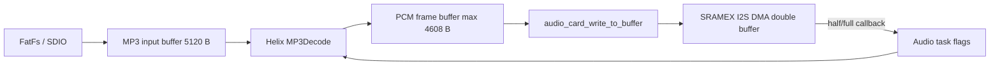

# Helix MP3 移植研究

> 调研日期：2026-07-15
> 目标平台：STM32F407ZGT6 / Cortex-M4F 168 MHz / Keil ARMCLANG 6.19 / CMSIS-RTOS2

> 实施更新（2026-07-18）：首版已完成集成和链接。上板复测排除了 DMA 欠载，但发现首版 wrapper 的 4096 B 窗口、手工帧长判断和严格参数返回会造成可恢复帧被丢弃。现已按参考工程改为 5120 B 窗口和 `2 * MAINBUF_SIZE` 补数阈值；decoder、压缩输入、PCM 帧及 I2S DMA 双缓冲均从 `SRAMEX` 动态分配。上板日志还显示原 8 KiB Audio task 栈无剩余，已增至 12 KiB，并由 `audiostat` 实时报告余量。

> 故障修复（2026-07-18）：`audiostat` 显示输出误锁为 22050 Hz/单声道，而后续真实帧为 44100 Hz/双声道。原因是 `MP3FindSyncWord()` 只检查同步位，wrapper 又把欠主数据的假帧当成首个有效帧，并在恢复时把读取位置强制跳到窗口固定偏移。现改为相邻帧头确认、成功解码后锁定格式、显式输入游标和逐字节有界重同步；EOF 补零也不再计入有效压缩数据。

> 对齐修复（2026-07-18）：后续 22050 Hz/单声道文件仍出现周期性 `ERR_MP3_INVALID_HUFFCODES` 和随机假帧。确认 FatFs 会把整扇区直接读到任意对齐的用户指针，而 SDIO DMA 配置为 word 传输，`sd_diskio.c` 却未启用模板自带的 `ENABLE_SCRATCH_BUFFER`。现已在 CubeMX USER CODE 区启用 512 B 对齐 scratch；非对齐读写先经 DMA-safe 缓冲再复制，避免压缩流边界被覆盖。

## 1. 结论

`Middlewares/libhelix` 可以用于给现有 `Media/Player.c` 增加 MP3 播放，但当前新增目录还不是可直接编译、链接和播放的完整组件。

已确认的正面结果：

- Helix 是定点 Layer III 解码器，适合 Cortex-M4F，不依赖浮点运算。
- 应加入工程的 14 个 C 文件使用项目实际的 ARMCLANG 6.19、Cortex-M4 编译参数进行了单文件验证，结果为 **14/14 通过**。
- `asmmisc_rvds.s` 与 `asmpoly_thumb2_rvds.s` 使用同版本 Keil `armasm` 验证，结果均为 **0 error**；只有 legacy assembler deprecated 警告。
- Helix 每帧输出 16-bit PCM，现有 `audio_card_open_prepare()`、双半缓冲 DMA 和回调唤醒模型可以复用。
- 按 MP3 一帧对应一个 DMA 半缓冲设计，最短补数期限约为 24 ms，架构上可行。

当前不能直接集成的原因：

1. `mp3dec.h` 引用了缺失的 `helix_support.h`，`helix_malloc/free/memcpy/memmove` 尚未适配本项目。
2. `MDK-ARM/Star Gamer.uvprojx` 中没有 Helix 源文件组，也没有 `Middlewares/libhelix` 的头文件路径。
3. `polyphase.c` 在 `ARM_ADS` 分支下缺少 `MADD64`，ARMCLANG 实测编译失败；必须用 `asmpoly_thumb2_rvds.s` 替代，二者不能同时加入。
4. Player 当前把文件解析、WAV 读取、DMA 供数和任务生命周期写在同一模块中，需要抽出 codec 层才能安全加入 MP3。
5. GUI 文件过滤目前只有 `.wav`。
6. 尚未进行完整链接、上板解码耗时和连续播放验证。

因此建议结论是：**可以移植，技术风险可控；先完成最小 MP3 codec 适配和上板时序验证，再合入通用 Player。**

## 2. 当前库的能力边界

从 `mp3dec.c`、`mp3dec.h` 和 `bitstream.c` 可确认：

| 项目 | 结论 |
|---|---|
| 编码格式 | MPEG-1 / MPEG-2 / MPEG-2.5 Layer III |
| 输出 | 16-bit signed PCM，双声道时为 LRLR 交织 |
| 每帧采样 | MPEG-1 通常为 1152 samples/channel；MPEG-2/2.5 为 576 samples/channel |
| 声道 | 1 或 2 |
| 比特率 | 支持标准比特率表，也包含 free bitrate 处理代码 |
| VBR | 音频帧可以解码；总时长、Seek 仍需解析 Xing/Info 或 VBRI |
| ID3 | 库不处理 ID3v2/ID3v1，Player 必须跳过或忽略标签 |
| CRC | 读取 CRC 字段，但当前源码没有完成 CRC 校验 |
| Layer I/II | 不支持，`MP3GetNextFrameInfo()` 明确拒绝非 Layer III |

`mpadecobjfixpt.h` 只是 C++ 包装器声明，目录中没有对应实现，本项目不需要加入它。

## 3. 工程文件清单

建议在 Keil 中新增 `Middlewares/Helix` 分组并加入以下文件：

```text
bitstream.c
buffers.c
dct32.c
dequant.c
dqchan.c
huffman.c
hufftabs.c
imdct.c
mp3dec.c
mp3tabs.c
scalfact.c
stproc.c
subband.c
trigtabs.c
arm/asmmisc_rvds.s
arm/asmpoly_thumb2_rvds.s
```

不要加入：

```text
polyphase.c          # ARM_ADS 分支没有 MADD64，且会与 asmpoly 的符号重复
mpadecobjfixpt.h     # 无实现且 Player 使用 C API
```

需要新增 include path：

```text
../Middlewares/libhelix
../Middlewares/libhelix/port     # 若把适配文件放在 port 子目录
```

当前汇编可由 Keil 6.19 的 legacy `armasm` 编译。后续若升级到不再提供 `armasm` 的工具链，需要把两个小型数学函数改成 AC6 intrinsic/C 实现，并将 polyphase 汇编迁移到 integrated assembler 语法，或补全可编译的 C fallback。

## 4. Helix 平台适配层

建议新增：

```text
Middlewares/libhelix/port/helix_support.h
Middlewares/libhelix/port/helix_support.c
```

库实际只依赖四个外部接口：

```c
void *helix_memcpy(void *dst, const void *src, size_t n);
void *helix_memmove(void *dst, const void *src, size_t n);
void *helix_malloc(unsigned int size);
void helix_free(void *ptr);
```

适配原则：

- `helix_memcpy()` / `helix_memmove()` 委托 C 库 `memcpy()` / `memmove()`。
- `helix_malloc()` 使用 `sys_malloc(SRAMEX, (u32)size)`。
- `helix_free()` 使用 `sys_free(SRAMEX, ptr)`。
- 不在中断中调用 Helix 或分配内存；解码和释放均在 Player 线程中完成。
- Helix 的 Huffman/IMDCT 工作集统一从 `SRAMEX` 分配，不再占用内部主 SRAM。
- STM32F407 没有 D-Cache，不需要 cache clean/invalidate；I2S DMA 缓冲区使用 DMA 可访问的 `SRAMEX`，不能放 CCM。

不建议直接把下载示例中的 `mem_malloc()` / `mem2_malloc()` 实现复制进来，因为它不符合本项目分配器和并发模型。

## 5. 推荐 Player 架构

保留现有 Player 的状态机、暂停/恢复/停止、DMA 回调和任务清理逻辑，把格式相关部分拆成小型 codec 接口：

```c
typedef enum
{
    PLAYER_CODEC_WAV = 0,
    PLAYER_CODEC_MP3
} Player_Codec_t;

typedef struct
{
    Player_Codec_t codec;
    u32 duration_seconds;
    u32 sample_rate;
    u32 bitrate;
    u8 channels;
    u8 bits_per_sample;
} Player_Info_t;
```

codec 至少提供 `open`、`read_pcm`、`close` 三个操作。WAV codec 的 `read_pcm` 只是从 FatFs 读取 PCM；MP3 codec 维护 Helix handle、压缩输入缓冲、剩余字节和 PCM 帧缓冲。这样 DMA 供数、线程事件和 UI 状态只保留一套。

建议文件边界：

```text
Media/Player.c             # 通用状态机、任务、DMA 供数和公开 API
Media/Player_WAV.c/.h      # RIFF/WAV 解析及 PCM 读取
Media/Player_MP3.c/.h      # ID3、流式补数、Helix 解码及错误恢复
```

首版若希望减少改动，也可以暂时把两个 codec 保留为 `Player.c` 内部静态函数，但不要复制出第二套暂停、停止和 DMA 任务。



## 6. MP3 流式解码流程

### 6.1 启动

1. `PlayerStart()` 按扩展名选择 codec，但 codec 自身仍要校验文件内容。
2. 打开 `FIL`，若开头为 ID3v2，按 4 字节 synchsafe size 跳过完整标签；有 footer 标志时再跳过 10 字节 footer。
3. 分配 5120 B 压缩输入缓冲和最大 4608 B PCM 缓冲。
4. 调用 `MP3InitDecoder()`；失败应返回明确的内存错误。
5. 填满输入缓冲，用 `MP3FindSyncWord()` 找同步字并直接解码首帧，再用 `MP3GetLastFrameInfo()` 取得采样率、声道数和输出样本数。
6. 解码到第一帧有效 PCM 后，以 `frame_info.outputSamps * sizeof(s16)` 作为 `audio_card_open_prepare()` 的 `pkg_size`。
7. 预解码并填好两个 DMA 半缓冲后再调用 `audio_card_start()`，避免启动即欠载。

Helix 的 `outputSamps` 已包含所有声道。例如 MPEG-1 stereo 为 2304 个 `s16`，即 4608 B；mono 为 1152 个 `s16`，即 2304 B，现有声卡层会扩展成双声道 DMA 数据。

### 6.2 补数规则

输入缓冲必须与 PCM 缓冲分离。建议在每次找帧/解码前执行：

1. 当剩余压缩数据少于 `2 * MAINBUF_SIZE`（3880 B）时，把剩余数据 `memmove` 到缓冲头。
2. 用 `f_read()` 填满余下空间，更新 `read_ptr` 和 `bytes_left`。
3. 找不到 sync 时至少保留最后 1 字节，再继续补数，防止同步字跨越两次读取。
4. 用 `MP3FindSyncWord()` 定位后直接调用 `MP3Decode()`，由 Helix 更新输入指针和剩余字节；不要在 wrapper 中重复计算帧长。

参考工程使用 5120 B 窗口，并在同步或解码失败时保留 `2 * MAINBUF_SIZE - 1` 字节后重新补数。可恢复错误只计数和重同步，不能立即映射成 Player 的 unsupported stream。

### 6.3 每次 DMA 事件

每个空闲半缓冲解码一帧：

1. 补充 MP3 输入数据。
2. 查找 sync，并调用 `MP3Decode(..., useSize = 0)`。
3. `MP3GetLastFrameInfo()` 获取本帧参数。
4. 验证采样率、声道和 `outputSamps` 与启动时一致。
5. 将 PCM 交给 `audio_card_write_to_buffer(idle_index, pcm, pcm_bytes)`。

运行中如果格式参数变化，首版应停止并报 unsupported stream，不要在 DMA 活动期间直接重配 I2S。

### 6.4 错误策略

| Helix 返回值 | 建议处理 |
|---|---|
| `ERR_MP3_NONE` | 正常输出 PCM |
| `ERR_MP3_MAINDATA_UNDERFLOW` | 文件开头或 Seek 后允许丢弃该帧，继续建立 bit reservoir |
| `ERR_MP3_INDATA_UNDERFLOW` | 非 EOF 时视为补数逻辑错误；EOF 时进入排空流程 |
| `ERR_MP3_INVALID_FRAMEHEADER` | 至少前移 1 字节后重新找 sync，限制连续重同步次数 |
| 其他 invalid 错误 | 丢弃损坏帧；连续错误达到阈值后停止，避免无限循环占满 CPU |
| `ERR_MP3_OUT_OF_MEMORY` / init 失败 | 关闭文件、释放已分配资源并返回内存错误 |

Seek 后必须 `MP3FreeDecoder()` + `MP3InitDecoder()` 重建 bit reservoir，并丢弃若干欠主数据帧后再恢复 DMA。

## 7. DMA 缓冲与实时预算

### 7.1 一帧对应一个半缓冲

| MP3 类型 | PCM 字节/帧（stereo） | 帧时长 |
|---|---:|---:|
| MPEG-1, 44.1 kHz | 4608 B | 26.12 ms |
| MPEG-1, 48 kHz | 4608 B | 24.00 ms |
| MPEG-1, 32 kHz | 4608 B | 36.00 ms |
| MPEG-2, 22.05 kHz | 2304 B | 26.12 ms |

因此最短 deadline 约为 24 ms。`f_read + MP3Decode + PCM copy/volume` 的上板最坏时间建议控制在 12 ms 内，留出至少 50% 调度余量。

I2S 回调中只能设置 CMSIS-RTOS2 thread flag，不能执行文件读取、解码或内存分配。当前 `audio_feeder()` 的方向是正确的。

### 7.2 当前声卡接口需要先修正的细节

当前 `audio_card_write_to_buffer()` 中清空目标半缓冲的 `memset` 被注释，而且 `pkg_size == 0` 会直接返回，不会写入静音。现有 Player 的 EOF drain 逻辑因此可能重放旧半缓冲内容。

MP3 接入前应满足以下任一方案：

- 每次写入前清零整个目标半缓冲，再覆盖有效 PCM；或
- 新增明确的 `audio_card_write_silence(index)`，EOF 时调用两次；或
- 对末帧手工补零到固定 package size。

推荐新增显式 silence API，正常完整 MP3 帧不必承担额外整块清零开销。

如果一次唤醒同时收到 half/full 两个 flag，说明任务至少错过了一个供数期限。当前 Player 只补一个 idle half，不能消除已经发生的欠载；应记录 deadline miss，并在调试统计中暴露，而不是把它当作普通事件。

## 8. 内存与 Flash 预算

### 8.1 RAM

`buffers.c` 注释给出的 32-bit 结构大小合计为 23,824 B；按本项目 32 B block 向上取整后约为 23,968 B。

| 项目 | 最坏占用 | 建议内存池 |
|---|---:|---|
| Helix decoder state | 23,968 B（含块取整） | SRAMEX |
| MP3 压缩输入 | 5,120 B | SRAMEX，SDIO DMA 可访问 |
| PCM 临时帧 | 4,608 B | SRAMEX |
| I2S 双半缓冲 | 9,216 B | SRAMEX，DMA 可访问 |
| Audio task stack | 12,288 B | SRAMCCM |
| 合计 | 约 43 KiB SRAMEX + 12 KiB CCM | 约 55 KiB |

MP3 播放时 decoder、输入、PCM 和 DMA 最大实用约 43 KiB，统一从共享 `SRAMEX` 池动态分配，Stop 和自然 EOF 后释放块。

原 8 KiB Audio task 栈在上板错误路径中测得 `task_stack_free=0`，因此提高为 12 KiB。`audiostat` 在任务运行时通过 CMSIS-RTOS2 读取实时 high-water 余量；需要在最重的 320 kbps/48 kHz/stereo 文件上继续验证。不要未经测量把 decoder state 放进 CCM；当前 CCM 还承担 default、LVGL、key、timer、Player 等线程栈。

### 8.2 Flash

同源 STM32F407 参考工程的 AC5 静态库对象统计为：

- Code：19,342 B
- RO data：13,406 B
- 合计：32,748 B（约 32.0 KiB）

ARMCLANG 6.19 的最终尺寸会因优化和链接消除而变化，应以本工程 `.map` 为准。建议预留 40 KiB Flash 预算。

## 9. Player 与 GUI 的必要改动

1. 将 `Wave_Infomation` 泛化为 `Player_Info_t`，把 `WAV_Second` 改为格式无关的 `duration_seconds`，增加 codec 和 bitrate。
2. `PlayerStart()` 增加 `.mp3` 分派并保持内容校验。
3. 把 `WavTaskHandle/WavFile/WavTaskAttr` 等命名改成格式无关名称，继续复用现有 CMSIS-RTOS2 flags。
4. 保证所有退出路径都按逆序执行：停止 DMA、注销回调、释放 decoder、释放 codec buffer、关闭文件、注销线程、最后退出线程。
5. `GUI_Player.c` 的扩展列表加入 `.mp3`，空目录文案由 `No WAV files` 改为格式无关文本。
6. GUI 当前只显示采样率/声道/位深，可以直接显示 MP3 的 16-bit PCM 信息；VBR 总时长在 Xing/VBRI 未实现前应显示未知，不要用首帧 bitrate 估算为精确值。

## 10. 推荐实施顺序

### 阶段 A：库可链接

- 增加 `helix_support.h/.c`。
- 在 Keil 中加入 14 C + 2 ASM，明确排除 `polyphase.c`。
- 增加 include path，完成全工程链接。
- 检查 `.map` 中 Flash、RW/ZI 和未解析符号。

### 阶段 B：最小 MP3 播放

- 实现 ID3v2 跳过、5120 B 流式补数和首帧探测。
- 单独实现 `Player_MP3` codec。
- 预填两个 DMA half 后启动，支持播放到 EOF 和 Stop。
- 暂不做 Seek、封面、ID3 文本和精确 VBR 时长。

### 阶段 C：并入完整 Player

- 复用 Pause/Resume/Stop 状态机。
- 修正 EOF silence 和 deadline miss 统计。
- GUI 增加 `.mp3` 并泛化信息结构。
- 加入 CBR/VBR 时长与 Seek；Seek 后重建 decoder。

## 11. 上板验证清单

至少准备以下文件：

| 用例 | 目的 |
|---|---|
| 44.1 kHz / stereo / 128 kbps CBR | 基本功能 |
| 48 kHz / stereo / 320 kbps CBR | 最短 deadline 与高复杂度 |
| 32 kHz / mono | mono 扩双声道路径 |
| 22.05 kHz MPEG-2 | 576 samples/channel 路径 |
| VBR + Xing/Info | VBR 连续解码与时长 |
| 大 ID3v2 + 封面 | 标签跳过，避免把图片扫描为音频帧 |
| 无 ID3 文件 | 首帧直接同步 |
| 截断/损坏文件 | EOF、重同步、无死循环 |
| 非 Layer III 伪装为 `.mp3` | 格式拒绝 |

必须记录：

- `f_read` 最大耗时；
- 单帧 decode 最大耗时与 DWT cycle 数；
- `audio_card` half/full、late write、underrun 和 DMA error；
- 同时收到 half/full flag 的次数；
- Audio task 最小剩余栈；
- 播放前后 `sys_mem_perused(SRAMEX/SRAMCCM)`，确认 Stop 和自然 EOF 后回落；
- 连续切换 WAV/MP3 100 次无内存增长；
- 暂停、恢复、停止、自然结束时无爆音和旧缓冲重复。

建议验收门槛：48 kHz/320 kbps/stereo 连续播放 30 分钟，decode + read + copy 最大耗时小于 12 ms，`late_write_count == 0`，无 half/full 合并事件，无 DMA/I2S error，无堆占用增长。

## 12. 风险与发布前置条件

- **许可风险**：源码头声明 RPSL 1.0 / RCSL 1.0，但 `Middlewares/libhelix` 中没有完整 LICENSE 文件。产品分发前必须确认源码来源、适用许可、源码披露义务和第三方 notice；本结论不是法律意见。
- **工具链风险**：当前依赖已弃用的 legacy `armasm`，短期可用，升级工具链前必须迁移汇编。
- **实时风险**：工作集迁入内部 SRAM 后仍必须以上板 worst-case 测量为准；48 kHz/320 kbps 文件需满足单次 decode + read + copy 小于 12 ms。
- **数据恢复风险**：该 Helix 版本较老，坏帧和 underflow 会部分移动输入指针，wrapper 必须做有界重同步，不能无限重试同一数据。
- **功能边界**：第一版只承诺常规 Layer III 文件顺序播放；精确 VBR 时长、Seek、ReplayGain、gapless 和标签显示应分别实现和验收。

## 13. 调研证据

- 本项目 Helix API：`Middlewares/libhelix/mp3dec.h`
- 内部内存：`Middlewares/libhelix/buffers.c`
- 平台数学分支：`Middlewares/libhelix/assembly.h`
- 当前 WAV Player：`Media/Player.c`
- 当前 I2S DMA：`BSP/i2s.c`
- 当前 GUI 过滤：`GUI/GUI_Player.c`
- 同源本机参考工程确认了原始 `helix_support` 接口和 14 C + 2 ASM 文件清单；参考工程使用 AC5，因此只作为来源交叉验证，不直接复用其静态库。

本次只完成研究、单文件编译/汇编验证和移植方案，没有修改 Player/I2S/GUI，也没有完成全工程链接或硬件播放测试。
